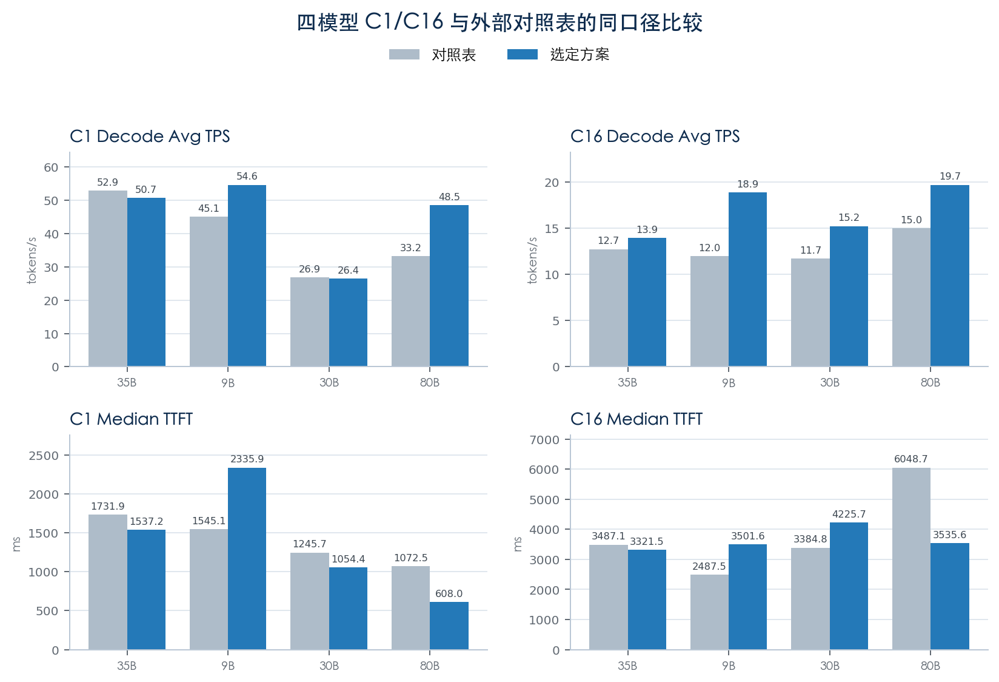
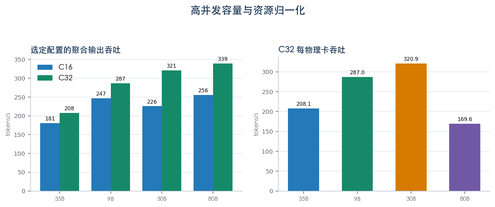

# GR308 Lab

风华 GR308 上的推理框架适配、性能调优、算子实验和结果归档。

本仓库整理于 2026-10-15，实验主要发生于 2026 年 9 月。代码覆盖 Qwen 文本模型、Wan2.2、Qwen-Image-2.1、MiniMax H3，以及 GRServe 本地原型。报告中的测量结果与工程状态均保留其时间和证据边界。

## 从这里开始

- [代码导航](CODE_MAP.md)：各模块的用途、入口和测试位置。
- [报告索引](REPORTS.md)：PDF、Markdown、指标数据和样例输出。
- [环境与复现说明](REPRODUCIBILITY.md)：本地检查、服务器依赖与历史路径。
- [恢复代码说明](archive/recovered/README.md)：找回的历史版本及 H3 缺失项。
- [第三方代码与许可说明](THIRD_PARTY_NOTICES.md)：保留原许可证与来源。
- [整理清单](docs/package/source-manifest.json)：原文件相对路径、原始/发布版哈希。

## 目录

```text
projects/
  grserve-mac-mvp/                  C++ Engine / HAL / RPC + Python API 原型
  gr308-three-card-mtp1-graph32/     Qwen 多卡、MTP、Graph 调优矩阵
  h3-sglang-gr308/                  H3 平台适配、W4A8 验证与报告
  qwen-image21-omni-fant/           TP2、分阶段推理、VAE 分块与 HIP 原型
sglang-fant-platform/              SGLang FANT 平台插件
sglang-fant-adaptation/            SGLang 兼容源码、探测及补丁
tools/                            Wan2.2 适配、质量对比和模型格式转换
  reporting/                      PDF 与图表生成器
scripts/                          Qwen A/B 测试与数据聚合
experiments/                      后期 MoE、EP 与 C32 实验脚本
archive/recovered/                从聊天历史恢复的完整版本及不完整片段
output/                           自有报告、指标、图表、图像和视频样例
docs/benchmarks/                   早期基线、验证报告和证据摘要
docs/design-history/              历史设计与实验计划
```

根目录的 `run_*`、`*_aggregate.py`、`aggregate_graph_baseline.py` 和 `test_*.py` 保留原有相邻位置，便于原测试和脚本继续解析文件。子工程保留各自内部结构，分别使用各自的 `pyproject.toml`。

## Qwen 四个模型：结果、代码与报告

本包包含以下 **4 个模型方案**。9B、30B 的 C1/C16 结果来自每组 64 请求的正式测试；35B、80B 的最优结果来自单轮短测（C1 16 请求、C16 32 请求），仍需补齐正式稳定性复测。

| 模型 | 选定配置概要 | C16 聚合输出吞吐 | 测试状态 | 对应代码 | 对应报告 |
|---|---|---:|---|---|---|
| **Qwen3.5-9B** | 双 TP1 / DP2，MTP4，batch 4096，自动 KV | **247.16 tok/s** | 正式测试 | [正式测试入口](projects/gr308-three-card-mtp1-graph32/scripts/gr308_final_high_throughput.py)中的 `final_specs()["9b"]`；[C32 补测](experiments/remote-bench/gr308-9b-80b-c32-short-20260917.py)中的 `matrix()["9b"]` | [调优总结 §5.1](output/风华_GR308_Qwen系列调优结果总结_20260917/风华_GR308_Qwen系列调优结果总结_20260917.md#51-qwen35-9b) |
| **Qwen3-30B-A3B** | TP2，不开 EP，batch 4096，固定 8 GiB KV，异步调度 | **225.67 tok/s** | 正式测试 | [正式测试入口](projects/gr308-three-card-mtp1-graph32/scripts/gr308_final_high_throughput.py)中的 `final_specs()["30b"]`；[MoE / EP 实验](experiments/moe-campaign-20260917/campaign.py) | [调优总结 §5.2](output/风华_GR308_Qwen系列调优结果总结_20260917/风华_GR308_Qwen系列调优结果总结_20260917.md#52-qwen3-30b-a3b) |
| **Qwen3.6-35B-A3B** | TP2，MTP4，batch 4096，自动 KV，同步调度 | **180.64 tok/s** | 最佳短测候选 | [MTP4 短测矩阵](projects/gr308-three-card-mtp1-graph32/scripts/gr308_35b_mtp4_short_matrix.py)中的 `D-mtp4-g64-b4096` | [调优总结 §5.3](output/风华_GR308_Qwen系列调优结果总结_20260917/风华_GR308_Qwen系列调优结果总结_20260917.md#53-qwen36-35b-a3b) |
| **Qwen3-Next-80B-A3B-Instruct** | TP4，MTP3，batch 2048，固定 8 GiB KV，同步调度 | **255.93 tok/s** | 最佳短测候选 | [早期 MTP0/1 短测](projects/gr308-three-card-mtp1-graph32/scripts/gr308_80b_short_tuning.py)；[MTP3 C32 补测](experiments/remote-bench/gr308-9b-80b-c32-short-20260917.py)中的 `matrix()["80b"]` | [调优总结 §5.4](output/风华_GR308_Qwen系列调优结果总结_20260917/风华_GR308_Qwen系列调优结果总结_20260917.md#54-qwen3-next-80b-a3b-instruct) |

四个模型共同对应 [2026-09-17 完整性能测试与调优报告（PDF）](output/pdf/风华_GR308_Qwen系列并发性能测试与调优报告_20260917.pdf)。精确数值和测试分类见 [结果 CSV](output/风华_GR308_Qwen系列调优结果总结_20260917/data/final_metrics.csv)，图表数据见 [报告数据 JSON](output/风华_GR308_Qwen系列并发性能测试与调优报告_20260917/data/report_data.json)。

**代码版本说明：**35B 的最优结果对应上表的 D 组；`gr308_final_high_throughput.py` 中的 35B 是较早的 MTP3 配置。80B 已收录的 MTP3 入口运行 C32 补测，不能直接作为报告中 C16 255.93 tok/s 的原始测量脚本；该 C16 结果由报告与指标数据保留，原始独立入口尚未确认。运行入口时还会依赖同目录模块与服务器环境，详见 [代码导航](CODE_MAP.md) 和 [复现说明](REPRODUCIBILITY.md)。

### 调优结果对比图

下面直接展示本包自有报告中的 PNG 图表。图片使用仓库内相对路径，提交整个目录后可在 GitHub README 中显示；点击图片可查看原图。

**图 1：四个模型与外部参考表的 Decode Avg TPS、首 token 延迟（TTFT）对比。**Decode Avg TPS 越高越好，TTFT 越低越好。灰色为参考表，蓝色为选定方案；参考表不是本次重新运行的基线，该图也不等同于严格控制变量的调优前后实验。图中 TPS 是每请求 Decode 速率，与上表的聚合输出吞吐口径不同。



**图 2：选定方案的 C16 / C32 聚合输出吞吐，以及 C32 每物理卡吞吐。**9B、30B、35B 使用一张物理卡，80B 使用两张；C32 数据为短测。9B、30B、35B 输入/输出长度为 3072/1024，80B 为 1024/1024，跨模型柱高不能解释为同负载性能排名。



图表的证据范围与解释见 [分析报告](output/风华_GR308_Qwen系列并发性能测试与调优报告_20260917/analysis-output/analysis-report.md) 和 [统计附录](output/风华_GR308_Qwen系列并发性能测试与调优报告_20260917/analysis-output/stats-appendix.md)。

## 其他方向的已记录结果

| 方向 | 历史记录 | 状态 |
|---|---|---|
| Wan2.2 S2 | 端到端 1190.20 → 672.33 秒 | 有效 5 帧、3 步短测；121 帧完整负载未成功 |
| Qwen-Image-2.1 | TP2、分块解码与算子实验 | 各路径的结果与限制见独立报告；SDPA 原型尚未完成性能验收 |
| MiniMax H3 | 平台接入和 W4A8 路径验证 | 原生 W4A8 验证未通过；没有完整视频性能结论 |
| GRServe | Mac CPU/Mock/Fault 本地系统验证 | 不代表 GR308 原生推理框架或硬件性能 |

数值来自对应历史报告，本次整理没有重新进行 GPU 性能测试。不同输入长度、拓扑、并发和请求数的结果不能直接比较。

## 本地检查

Python 3.11 环境中：

```bash
python3 -m pip install -r requirements-dev.txt
python3 tools/verify_package.py
python3 tools/verify_package.py --cpu-tests
```

检查只运行语法、清单及列明的 CPU 测试，不启动容器或连接服务器。测试结果见 [VALIDATION.md](VALIDATION.md)。

服务器脚本保存了历史 `/data/...` 挂载布局、设备号、镜像标识及模型版本，运行前需按 [复现说明](REPRODUCIBILITY.md) 配置。公开副本中的主机地址为 `192.0.2.x` 示例地址，个人目录统一为 `USER`；它们不是可连接的部署配置。

## 归档与发布

仓库地址：[KunyuanComputing/gr308-lab](https://github.com/KunyuanComputing/gr308-lab)。仓库为私有，需要组织授予访问权限。

```bash
git clone https://github.com/KunyuanComputing/gr308-lab.git
cd gr308-lab
```

本仓库保存独立整理后的代码与报告，没有携带父仓库 Git 历史、worktree 指针、聊天全文、缓存、虚拟环境、模型大权重或完整第三方仓库。厂商手册与其他团队原始报告按用户要求不随包分发。

根目录 `CHECKSUMS.sha256` 列出了交付时的文件及其哈希；后续修改文件后，旧校验值将不再适用。

代码保留原版权和许可声明；未擅自为全部文件赋予统一开源许可证。未标明许可的自有代码需由权利人选择许可，详见 [THIRD_PARTY_NOTICES.md](THIRD_PARTY_NOTICES.md)。
