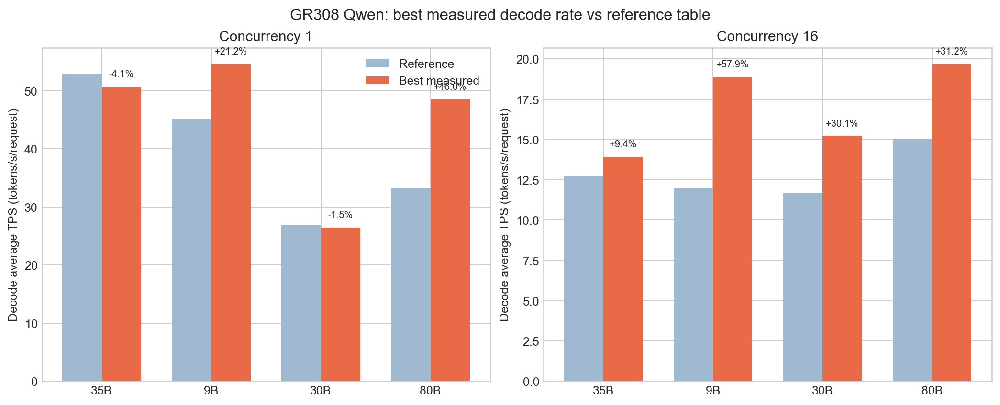
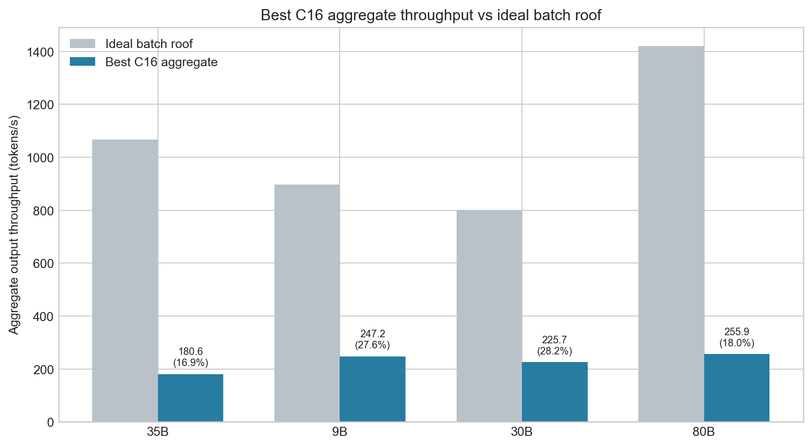

# 风华 GR308 Qwen 系列调优结果总结

版本：2026-09-17  
环境：GR308、vLLM 0.18.0、vllm_fant 1.1.0.20、BF16  
模型：Qwen3.5-9B、Qwen3-30B-A3B、Qwen3.6-35B-A3B、Qwen3-Next-80B-A3B-Instruct

## 1. 执行摘要

四个模型的高吞吐路线已经基本收敛：

- **9B** 的最佳方案是双 TP1 / DP2、MTP4、Graph `[4,8,16,32]`、batch 4096、自动 KV，C16 聚合吞吐为 **247.16 tok/s**。这是单物理卡最高的正式结果。
- **30B** 的最佳方案是纯 TP2、不开 EP、auto MoE backend、Graph `[4,8,16,32]`、batch 4096、block 800、8 GiB KV、async，C16 为 **225.67 tok/s**，C32 为 **320.90 tok/s**。
- **35B** 的最佳方案是 TP2、MTP4、Graph `[4,8,16,32,64]`、batch 4096、block 1088、自动 KV、同步调度，C16 为 **180.64 tok/s**，C32 为 **208.08 tok/s**。
- **80B** 的最佳方案是 TP4、MTP3、Graph `[4,8,16,32,64]`、batch 2048、block 1088、8 GiB KV、同步调度，C16 为 **255.93 tok/s**，但需要两张物理卡，折合 **127.97 tok/s/卡**。

整体上，9B 和 30B 的屋顶效率已达到约 28%，是当前最有部署性价比的两条路线。35B 和 80B 的系统屋顶效率仅约 17%–18%，主要瓶颈已不是简单调大 batch 或切换 Graph，而是 MoE kernel、推测验证成本、跨卡通信与调度效率。

## 2. 指标口径与证据等级

本报告严格分开两种 TPS：

- **Decode Avg TPS**：单请求平均解码速率，计算为 `1000 / mean TPOT(ms)`，与用户提供的图示口径一致。
- **聚合输出吞吐**：整个服务实例每秒完成的输出 token，用于高并发容量和理论屋顶对比。

图示只提供 Decode Avg TPS，未提供聚合吞吐，因此不能把图示值直接和 180.64、247.16 等数值比较。

证据等级：

- 9B、30B 的 C1/C16 最终值来自每组 64 请求的正式测试，失败数为 0。
- 35B MTP4 和 80B MTP3 的最优值来自单轮短测（C1 16 请求、C16 32 请求），是“最佳实测候选”，尚不是多轮稳定性验收结论。
- 短测候选未做至少 3 轮配对复测，因此本报告不声称统计显著性；小于 3% 的差异视为工程上基本持平。

## 3. 最优结果与图示对照

### 3.1 并发 1

| 模型 | 图示 TTFT | 最优 TTFT | 变化 | 图示 Decode TPS | 最优 Decode TPS | 变化 | 最优聚合 TPS | 证据 |
| --- | ---: | ---: | ---: | ---: | ---: | ---: | ---: | --- |
| Qwen3.6-35B-A3B | 1731.87 | 1537.19 | -11.2% | 52.91 | 50.75 | -4.1% | 47.21 | 短测 |
| Qwen3.5-9B | 1545.07 | 2335.93 | +51.2% | 45.09 | 54.64 | +21.2% | 48.62 | 正式 |
| Qwen3-30B-A3B | 1245.71 | 1054.43 | -15.4% | 26.85 | 26.43 | -1.5% | 25.76 | 正式 |
| Qwen3-Next-80B-A3B | 1072.45 | 607.98 | -43.3% | 33.23 | 48.52 | +46.0% | 47.13 | 短测 |

### 3.2 并发 16

| 模型 | 图示 TTFT | 最优 TTFT | 变化 | 图示 Decode TPS | 最优 Decode TPS | 变化 | 最优聚合 TPS | 证据 |
| --- | ---: | ---: | ---: | ---: | ---: | ---: | ---: | --- |
| Qwen3.6-35B-A3B | 3487.11 | 3321.47 | -4.7% | 12.74 | 13.93 | +9.4% | 180.64 | 短测 |
| Qwen3.5-9B | 2487.47 | 3501.62 | +40.8% | 11.97 | 18.90 | +57.9% | 247.16 | 正式 |
| Qwen3-30B-A3B | 3384.84 | 4225.69 | +24.8% | 11.70 | 15.22 | +30.1% | 225.67 | 正式 |
| Qwen3-Next-80B-A3B | 6048.71 | 3535.56 | -41.5% | 15.02 | 19.71 | +31.2% | 255.93 | 短测 |

解读：

- 9B 的主要价值是高并发吞吐，C16 Decode TPS 提升 57.9%，但 TTFT 增加 40.8%；应定位为吞吐档，不是低延迟档。
- 30B 的 C16 Decode TPS 提升 30.1%，代价是 TTFT 增加 24.8%。关闭 EP 是这个模型当前最明确的系统级决策。
- 35B 在 C16 同时改善 Decode TPS 和 TTFT，但 C1 Decode TPS 比图示低 4.1%，更适合并发服务。
- 80B MTP3 在 C1/C16 同时提升 Decode TPS 并降低 TTFT，是本轮最明显的综合收益，但仍需要正式复测。

## 4. 理论性能与实测最佳对照

| 模型 | 理想批处理屋顶 | 实测最佳 C16 聚合吞吐 | 系统屋顶效率 | Decode 阶段等效效率 | 物理卡数 | 每物理卡吞吐 |
| --- | ---: | ---: | ---: | ---: | ---: | ---: |
| Qwen3.6-35B-A3B | 1066 tok/s | 180.64 tok/s | 16.9% | 20.9% | 1 | 180.64 |
| Qwen3.5-9B | 896 tok/s | 247.16 tok/s | 27.6% | 33.8% | 1 | 247.16 |
| Qwen3-30B-A3B | 800 tok/s | 225.67 tok/s | 28.2% | 30.5% | 1 | 225.67 |
| Qwen3-Next-80B-A3B | 1420 tok/s | 255.93 tok/s | 18.0% | 20.2% | 2 | 127.97 |

说明：理想批处理屋顶和 Decode 阶段屋顶沿用前一轮理论计算模型，它们是规划估算，不是 GPU 硬件计数器的直接利用率。这个表适合用于模型间的相对部署决策。

### 4.1 为什么 9B 既有 97.6%，又有 27.6%

这两个数字均正确，但表示不同并发场景和不同屋顶：

| 9B 口径 | 实测 | 理论分母 | 效率 | 含义 |
| --- | ---: | ---: | ---: | --- |
| C1 单副本 Decode 效率 | 54.64 tok/s | 56 tok/s | **97.6%** | DP2 在 C1 时只有一个 TP1 副本处理请求，测量单请求解码速率 |
| C1 单副本聚合吞吐效率 | 48.62 tok/s | 56 tok/s | **86.8%** | 计入 TTFT 和请求间隙后的端到端输出吞吐 |
| C16 整卡批处理屋顶效率 | 247.16 tok/s | 896 tok/s | **27.6%** | 两个 TP1 副本共同服务并发请求，对比整卡理想批处理屋顶 |
| C16 Decode 阶段等效效率 | 247.16 tok/s | 731.24 tok/s | **33.8%** | 只与 Decode 阶段估算屋顶比较 |

因此，之前所说的“接近 98%”是 **C1 单活跃副本的 Decode kernel/请求效率**，不代表双副本在 C16 时已达到整卡批处理理论峰值的 98%。并发下的 prefill、队列、调度、副本负载均衡和气泡使整体效率降至 27.6%。

## 5. 各模型调优过程与结果

### 5.1 Qwen3.5-9B

**最终选择**：TP1 + DP2、MTP4、Graph `[4,8,16,32]`、batch 4096、block 800、自动 KV、同步调度。

| 调优方向 | 结果 | 判断 |
| --- | --- | --- |
| MTP1 → MTP3 | C16 聚合吞吐由 205.71 升至 231.81 tok/s | 明确正收益 |
| MTP3 → MTP4 | 短测 C1 显著改善；C16 Decode TPS 小幅提高 | 适合吞吐优先 |
| batch 2048 → 4096 | C16 由约 215.8 升至 237–239 tok/s | 有效 |
| 固定 8 GiB KV → 自动 KV | C16 约 +0.9%，主要改善容量余量 | 保留自动 KV |
| TP2 → 双 TP1 / DP2 | 短测 C16 157.67 → 247.87 tok/s，约 +57% | 最大收益来源 |
| Graph32 → Graph64 | 未出现足以改变决策的稳定收益 | 保留 Graph32 |

瓶颈已从单模型计算转向 replica 负载均衡和服务层调度。下一阶段若继续优化，应优先比较内置 DP2 与双端口外部轮询，而不是继续扩大 Graph 矩阵。

### 5.2 Qwen3-30B-A3B

**最终选择**：TP2、不开 EP、auto MoE backend、Graph `[4,8,16,32]`、batch 4096、block 800、固定 8 GiB KV、async scheduling。

| 调优方向 | 结果 | 判断 |
| --- | --- | --- |
| Graph `[32]` → `[4,8,16,32]` | 改善小批次图命中和稳定性 | 保留 |
| batch 2048 → 4096 | C16 短测进入 218–222 tok/s 区间 | 有效 |
| sync → async | C16 约从 218.80 升至 221.52 tok/s | 小幅正收益 |
| block 800 → 1088 | 吞吐基本不变 | 保留 block 800 |
| 8 GiB KV → 自动 KV | C16 +0.9%，C32 -0.35% | 无稳定收益 |
| batch 4096 → 6144 | C16 +0.8%、C32 +0.2%，但 TTFT 增加约 30%–47% | 不采用 |
| auto → Triton grouped GEMM | C32 320.90 → 321.35 tok/s，仅 +0.14% | 视为持平，保留 auto |
| TP2 → TP2+EP2 | C16 185.86、C32 230.52 tok/s，分别回归约 16%和 28% | 明确不采用 |

30B 当前的主要瓶颈是专家路由后的小 GEMM 效率和调度，但现有 Triton grouped kernel 并未转化为明显的端到端收益。EP 的 all-to-all 和同步成本高于专家计算节省量。

### 5.3 Qwen3.6-35B-A3B

**最终选择**：TP2、MTP4、Graph `[4,8,16,32,64]`、batch 4096、block 1088、自动 KV、同步调度、auto MoE backend。

| 调优方向 | 结果 | 判断 |
| --- | --- | --- |
| MTP3 → MTP4 | 同为 batch 2048 时，C16 164.38 → 175.57 tok/s，约 +6.8% | 关键正收益 |
| batch 2048 → 4096 | MTP4 C16 175.57 → 180.64 tok/s，TTFT 5593.57 → 3321.47 ms | 同时改善吞吐与 TTFT |
| Graph64 → Graph128 | C16 聚合吞吐约 +0.5%，Decode TPS 略降 | 无足够收益 |
| batch 4096 → 6144 | C16 -0.50%，C32 +0.48%，TTFT 更高 | 保留 4096 |
| Triton grouped GEMM + 融合 | C16 167.69、C32 188.63 tok/s | 明显回归 |
| EP2 linear | C16 167.81、C32 185.50 tok/s，相对基线约 -7.1%/-10.8% | 不采用 |
| round-robin 专家放置 | 当前插件不支持，实际回退 linear | 未得到有效 A/B |
| C64 | Fantasy SSM kernel 因 `ssm_state_indices` 非连续布局失败 | 本轮停在 C32 |

35B 已接近当前软件栈的参数调优上限。若要有两位数提升，需要内核层改造：将 token sorting、专家分组、grouped GEMM 和 expert output combine 形成后端原生融合路径，并优化 MTP verify kernel。继续只调 batch/Graph 的预期收益已低于 3%。

### 5.4 Qwen3-Next-80B-A3B-Instruct

**最终选择**：TP4、MTP3、Graph `[4,8,16,32,64]`、batch 2048、block 1088、固定 8 GiB KV、同步调度。

| 调优方向 | 结果 | 判断 |
| --- | --- | --- |
| 无 MTP → MTP1 | C16 177.71 → 231.30 tok/s，约 +30% | 最大收益来源 |
| eager → Graph32/64 | C1 提升，Graph64 C16 达 231.98 tok/s | 保留 Graph64 |
| MTP1 → MTP2 | C16 231.98 → 251.49 tok/s | 明确正收益 |
| MTP2 → MTP3 | C16 251.49 → 255.93 tok/s；C1 36.75 → 47.13 tok/s | MTP3 最优 |
| batch 2048 → 4096（MTP1） | 吞吐近似持平，TTFT 降低 | 可作低 TTFT 档，不是吞吐档 |
| sync → async | C16 略降，TTFT 明显恶化 | 不采用 |
| TP4 + EP4 | C16 233.93 tok/s，比 TP4/MTP3 低 8.6%，TTFT 高 21.2% | 不采用 |
| TP2×DP2×EP | 原始 DP 设备被解析为 CUDA；切换 CPU DP 后通过原错误，但 profile run 触发 Fantasy firmware semaphore 超时 | 当前软件栈不可用 |

80B 的最高优先级不是 EP，而是完成 MTP3 的多轮正式复测，同时统计 draft acceptance 和 verify 开销。如果继续优化跨卡方案，应先修复 DP/EP 的设备类型适配和固件同步，而不是继续扩大参数矩阵。

## 6. 跨模型优化规律

1. **MTP 是 35B/80B 的核心增益器**。35B 选 MTP4，80B 选 MTP3；最优深度取决于接受率与 verify 成本，不是越大越好。
2. **Graph 需要覆盖实际批次，但扩到 64/128 后收益迅速递减**。主要价值是避免 eager 路径，不是无限增加捕获桶。
3. **Batched tokens 的最优值是非单调的**。9B/30B/35B 均在 4096 附近收敛；6144/8192 只产生小幅吞吐波动和更大 TTFT。
4. **自动 KV 不是普遍性加速开关**。9B/35B 可用于释放容量；30B 性能持平；80B 曾在初始化阶段失败，暂保留固定 8 GiB。
5. **当前 EP 在三个 MoE 模型上均未带来端到端正收益**。专家计算节省被 all-to-all、同步、token dispatch/combine 和小批次 kernel 利用率抵消。
6. **custom all-reduce 全程保持开启**。所有推荐配置均不包含 `--disable-custom-all-reduce`。

## 7. 部署建议

| 场景 | 首选 | 理由 |
| --- | --- | --- |
| 单卡最高吞吐 | Qwen3.5-9B | 247.16 tok/s/卡，系统屋顶效率 27.6% |
| 单卡 MoE 高并发 | Qwen3-30B-A3B | C32 320.90 tok/s，无 EP 配置稳定 |
| 较大 MoE，兼顾 C16 吞吐 | Qwen3.6-35B-A3B | MTP4 C16 180.64 tok/s，但屋顶效率较低 |
| 最大模型能力 | Qwen3-Next-80B-A3B | C16 255.93 tok/s，但占用两卡，每卡效率最低 |

如果部署决策以性价比和吞吐为主，建议优先 9B 和 30B。如果必须使用 35B/80B，应将 MTP 配置固化并补齐稳定性测试；在当前后端版本上不建议启用 EP。

## 8. 尚需完成的验收

- 对 35B MTP4 和 80B MTP3 各执行至少 3 轮 C1/C16、64 requests 正式复测。
- 固定 seed、物理卡、CPU NUMA 亲和性和启动顺序，报告跨轮变异系数。
- 确认所有请求完整输出 1024 tokens，`failed=0`，并留存 MTP acceptance、Graph replay 和硬件健康证据。
- 将小于 3% 的改进仅视为候选，不直接修改生产配置。

## 9. 证据索引

主要远端结果目录：

- `/data/infra/benchmarks/gr308-final-high-throughput-20260915/`
- `/data/infra/benchmarks/gr308-adaptive-short-matrix-20260915/`
- `/data/infra/benchmarks/gr308-35b-mtp4-short-matrix-ready-20260915/`
- `/data/infra/benchmarks/gr308-80b-short-tuning-20260915/`
- `/data/infra/benchmarks/gr308-moe-c32-ep-short-20260917-attempt4/`
- `/data/infra/benchmarks/gr308-final-c16-c32-c64-tune-20260917/`
- `/data/infra/benchmarks/gr308-final-c16-c32-last-mile-20260917/`
- `/data/infra/benchmarks/gr308-final-35b-c32-recheck-20260917/`
- `/data/infra/benchmarks/gr308-35b-30b-native-ep2-20260917/`
- `/data/infra/benchmarks/gr308-80b-tp2-ep2-dpfix-20260917/`
- `/data/infra/benchmarks/gr308-80b-tp2-ep2-no-mtp-20260917/`
- `/data/infra/benchmarks/gr308-80b-tp4-ep4-20260917/`

本地附件：

- [归一化指标数据](data/final_metrics.csv)
- [理论屋顶对比数据](data/theoretical_comparison.csv)
- [分析摘要](analysis-report.md)
- [统计附录](stats-appendix.md)
- [图表索引](figure-catalog.md)
